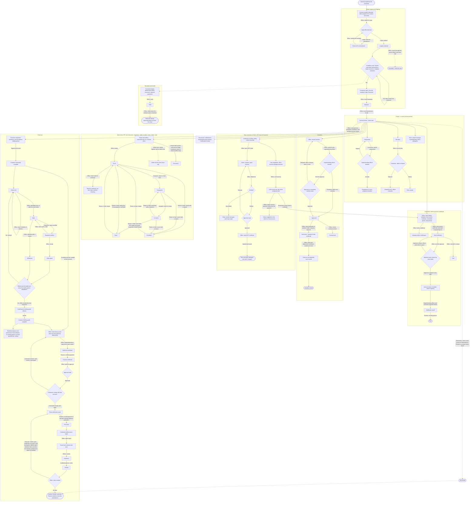

# Project module QA (contracts and projects)

Date: 2026-11-02. Tester: QA agent (Project module). Build: dev server on :3000, demo database. Browser: headless Chrome through DevTools Protocol, desktop 1440 wide. Scripts and screenshots: `C:\Users\MOHAMA~1\AppData\Local\Temp\claude\c--Users-MohamadHaikalHarizbi-projects-perolehan\2aa89ad0-6972-46e7-8fb0-199c5c2c82a5\scratchpad\qa-project\` (screenshot file names are in the table).

## Headline

- Every stage and tab I opened loads without an error and without console errors. Unknown ids give a clean 404.
- The demo database holds only two Active contracts, and both are showcase records (demo_con3, demo_con13). `demo_con15` does not exist (404). So no safe record exists for mutating work items, certificates, variations or EOT claims. Those cases are BLOCKED, not skipped silently. Nothing was created, changed or approved. This QA wrote no records.
- Bugs found: 0 Blockers, 2 Major (one is a coverage gap, not code), 3 Minor.

## 1. Workflow: award accepted to contract closed

Built from `src/lib/contract/status.ts`, `case-stage.ts`, `src/lib/work/move.ts`, `src/lib/payment/*`, `src/lib/closeout/*`, `src/lib/time/*`, `src/lib/performance/*` and the `*-actions.ts` files under `src/app/projects/[id]/`. Termination is drawn dotted: the status and a certificate kind exist, but I found no screen action that writes it.

Notes:
- "Office" is staff of the procuring office. Finance records payments and confirms the final account. The contractor acts only on what is shared with it (work items, site diary, programme, defects, signing blocks).
- A contract is cancelled only before execution. After execution it can only be terminated, then closed.
- A Closed contract is read-only: the act-by-status table (`src/lib/contract/act-status.ts`) refuses work, payment and variation acts.

## 2. Test table

Users: CWL = demo.chen.wei.ling, BK = demo.bala.krishnan, DJ = demo.daniel.anak.jelani, A1 = demo.admin1. Showcase records were opened read-only.

| Id | Scenario | Steps | Expected | Actual | Result | Screenshot |
|---|---|---|---|---|---|---|
| P-01 | Projects list loads | CWL open /projects | 9 cases, stage counts, filters | 9 cases (6 Awarding, 2 On site, 1 Cancelled or terminated), filters present | PASS | list.jpg |
| P-02 | Case default page for each case id | CWL open /projects/{con1, con2, con3, con13, lcn1, aw1, aw2, aw6, aw7} | Loads with header and stage strip | All load | PASS | - |
| P-03 | Award stage tabs (Overview, Approval, Letter, Distribution, Return, Routing) | CWL open each on con1, con3, aw1, aw2, aw6, aw7 | Loads | All load (aw6 Routing not reached before my run ended) | PASS | - |
| P-04 | Before signing tabs (Conditions, Securities) | CWL on con1, con3 | Loads | Load | PASS | - |
| P-05 | Signing tabs (Formation, Baseline) | CWL on con1, con3 | Loads | Load (con3 Formation 7k chars) | PASS | - |
| P-06 | Project stage tabs on con3: Overview, Work, Team, Site, Payments, Variations, Time, Documents | CWL open each | Loads | All load, no console errors | PASS | chen.wei.ling__projects_demo_con3_stage_project_tab_*.jpg |
| P-07 | Project stage tabs on con13 | same | Loads | All load | PASS | chen.wei.ling__projects_demo_con13_stage_project_tab_*.jpg |
| P-08 | Close-out tabs (Completion, Defects, Final account, Close, Work) on Active con3 and con13 | CWL open each | Loads; says the stage is not reached | Load with short content | PASS | chen.wei.ling__projects_demo_con3_stage_close_out_tab_*.jpg |
| P-09 | History tab | CWL open ?tab=history on con3 and con13 | Loads | Loads (46k and 73k characters, see Minor 3) | PASS | - |
| P-10 | Linked records: interim, advance, LAD warning, non-completion, EOT and VO certificates, sum adjustment, 3 variations, 1 EOT claim, 6 project documents, supply invoices | CWL open each link from con13 and con3 tabs | Page loads | 38 pages checked, all load. The last con3 certificates (demo_hct4, hct5, wlt1, wlt2, qct1 extras) were cut by my timeout and not opened | PASS | - |
| P-11 | Unknown case id | CWL /projects/nonexistent_id | Clean 404 | 404 | PASS | t5_chen.wei.ling__projects_nonexistent_id.jpg |
| P-12 | Unknown certificate, EOT, variation, document id under con3 | CWL open each | Clean 404 | All 404 | PASS | t5_chen.wei.ling__projects_demo_con3_*.jpg |
| P-13 | demo_con15 (named in the brief) | CWL and BK open | Loads | 404: the record does not exist | PASS as 404 (see M2) | - |
| P-14 | My work, CWL | open /my-work | Items assigned to her, late first | Late 2: SI 1 and SI 3 on con3; both match the Work list | PASS | t5_chen.wei.ling__my_work.jpg |
| P-15 | My work, DJ | open /my-work | Insp 1 late, Defect 2 later | Matches con3 Work list | PASS | t5_daniel.anak.jelani__my_work.jpg |
| P-16 | My work, BK | open /my-work | To check: RFI 3. Assigned: Act 1 and RFI 4 | RFI 3 and Act 1 shown. RFI 4 missing, footer says "Showing the first 2 of 3" with nothing cut | FAIL (M1) | t5_bala.krishnan__my_work.jpg |
| P-17 | My work, A1 | open /my-work | Empty state | "Nothing on you." | PASS | t5_admin1__my_work.jpg |
| P-18 | My approvals, CWL | open /approvals | Her steps, including the con3 interim certificate | 3 for her, includes "XI202600799 Interim payment certificate, Recommend, 31 days" | PASS | t5_chen.wei.ling__approvals.jpg |
| P-19 | My approvals, A1 | open /approvals | Nothing waiting | "Nothing is waiting for you." | PASS | t5_admin1__approvals.jpg |
| P-20 | No right to act: admin account reads a contract | A1 open con3 Overview, Work, Payments | Read only, commercial acts refused | Reads. Kick-off "Schedule" gives the reason "Only the S.O. ... can do this today". SULIT value hidden with the administrator reason. Work tab still shows the add-item box (Minor 1) | PASS with Minor 1 | t5_admin1__projects_demo_con3.jpg |
| P-21 | Not-executed contract is read-only: Work (con2) | CWL open con2 Work | No add box, reason shown | "The contract is not executed yet: this is recorded once it is." No add input | PASS | t5_chen.wei.ling__projects_demo_con2_stage_project_tab_work.jpg |
| P-22 | Not-executed contract: Record a variation (con2) | Open the drawer, press Record | Submit blocked with reason | Record disabled; footer "The contract is not executed: a variation is recorded on an executed contract." Two fields labelled "Originated by" (Minor 2) | PASS with Minor 2 | t6_var.jpg, t6_var_submit.jpg |
| P-23 | Not-executed contract: Open a claim (con2) | Open the drawer, press Open | Blocked with reason | Open disabled; "The contract is not executed yet: this is recorded once it is." | PASS | t6_eot_submit.jpg |
| P-24 | Not-executed contract: Open a valuation (lcn1) | Open the drawer, press the button | Blocked | No write happened; the Payments tab says "No baseline version is in force today" | PASS | t6_val_submit.jpg |
| P-25 | Close-out on a contract not in force (con2) | CWL open close-out/completion | Says it opens later | "Opens once the contract is in force" | PASS | t5_chen.wei.ling__projects_demo_con2_stage_close_out_tab_completion.jpg |
| P-26 | Text hygiene on the 22 captured showcase screens | Search for undefined, NaN, null, raw codes, Invalid Date | None | None found | PASS | - |
| P-27 | con3 figures agree across tabs | Compare Overview, Payments, Variations | Same figures | Contract sum RM36,000; 1 interim issued RM12,000 before deductions (RM11,750 recommended); variation RM2,400 awaiting; revised sum RM36,000 | PASS | - |
| P-28 | Raise a work item (quick add, each type) | - | Item appears | No safe active contract (con3, con13 showcase; con15 absent; con1, con2, lcn1 not executed) | BLOCKED | - |
| P-29 | Move a work item: assign, start, send for review, send back with comment, done, cancel with reason, reopen | - | Per the move table | Same reason. The rules are covered by `src/lib/work/move.test.ts` and `work-flow.db.test.ts`; not driven in the browser | BLOCKED | - |
| P-30 | Comment Reply and Internal; share with contractor; defect item linked to the defect list | - | - | Same reason | BLOCKED | - |
| P-31 | Interim certificate: raise, send, approve, Finance pays | - | - | Needs a contract in force with a baseline. Existing certificate pages read fine (P-10) | BLOCKED | - |
| P-32 | Variation: record, submit, committee, adjustment | - | - | Drawer gating checked on con2 (P-22); con13 variation pages read fine | BLOCKED | - |
| P-33 | EOT claim: open, determine, certificate | - | - | Drawer gating checked (P-23); con13 claim page (Granted) reads fine | BLOCKED | - |
| P-34 | Practical completion, defects, making good, final account, close refusals, performance report second person | - | - | No contract is past Active. Covered by `closure.test.ts`, `final-gates.db.test.ts`, `performance-flow.db.test.ts` | BLOCKED | - |
| P-35 | Closed contract is read-only | - | - | No Closed contract exists (list shows Closed 0; con13 is still Active) | BLOCKED | - |
| P-36 | Contractor portal views | - | - | Portal not reachable on :3000 | BLOCKED | - |
| P-37 | Termination | Look for a terminate action | An action | None found; the status exists only in the lifecycle and certificate kinds | BLOCKED (not built as a screen) | - |
| P-38 | First-hit page speed on the dev server | Time the crawl | A few seconds | 3 to 16 s for the first hit of a tab on con3 (project/overview 16 s once) | Observation (Minor 3) | - |

Counts: 38 cases. PASS 25 (3 of them with a Minor noted), FAIL 1, BLOCKED 11, 1 observation.

## 3. Bugs (ranked)

### Blocker for the demo

None found.

### Major

**M1. My work drops an item, and its footer says something false.** A contractor-raised item that is In review and assigned to a staff member never appears in that person's My work. The footer reads "Showing the first 2 of 3. Open a project's Work tab for the rest." although nothing was cut off.
- Reproduce: sign in as demo.bala.krishnan, open /my-work. It shows RFI 3 (To check) and Act 1. RFI 4 "Spoil disposal site for the excavated material" on con3 (In review, assigned to Bala, raised by the contractor, due 03 Nov) is missing. Open con3 Work to see it.
- Likely cause (read in code, not changed): in `loadMyWork` (`src/lib/work/load.ts`) the "rest" query is `NOT { raisedByPersonId: me, status: IN_REVIEW }`. For a contractor-raised item `raisedByPersonId` is NULL, so the NOT is NULL in SQL and the row is dropped. The count query has no such NOT, so `more` is 1. This is the NOT-over-nullable trap that `case-stage.ts` already documents.
- Demo impact: only if you show Bala's My work.

**M2. No safe sandbox for Project action paths.** Not a code bug, but a gap and a demo risk. The only Active contracts are the two showcase ones, and demo_con15 does not exist. Every mutating Project flow is untested in the browser. Seed a QA contract, or rely on `npm test`, before trusting those flows live.

### Minor

1. **Admin account is offered "Add an item" on the Work tab.** A1 (settings only) sees the add box on con3 Work. In code, `createWorkItem` calls `staffForAct("TRANSACTION")`, which should refuse an administrator, so the likely result is a refusal after typing. I did not submit it, because a failure would have written to showcase con3. Reproduce: sign in as demo.admin1, open /projects/demo_con3?stage=project&tab=work.
2. **Two fields labelled "Originated by" in the Record a variation drawer.** One is the origin (select, "Choose: there is no default"); the other is the person (defaults to the signed-in user). Reproduce: /projects/demo_con2?stage=project&tab=variations, press "Record a variation". See t6_var.jpg.
3. **Dev-server slowness and heavy History.** The first load of a tab on con3 took 8 to 16 s while other testers were using the server, and one Overview hit took 16 s. con3 History is about 46k characters and con13 about 73k. Open each tab you will demo once beforehand. In dev mode the Next.js "N" badge covers the top-left brand logo in every screenshot.

## 4. Safe to demo / avoid

Safe, tested and clean:
- con3 (XI202600799) Overview, Work (List, 15 open items, late chips), Payments, Variations, Time, Documents, History. Chen's My work and My approvals.
- con13 (DEMO/KP/T/005/2026) is the richest record: 14 certificates (interim, advance, LAD warning, non-completion, EOT, VO, adjustment), 3 variations, 1 granted EOT claim, 6 project documents. All its pages open.
- con1, con2, lcn1 as examples of gating: the refusal reasons read well.
- The five award stage tabs on aw1, aw2, aw7.

Avoid:
- Bala's My work (M1).
- Any mutation on con3 or con13 unless you mean to change the showcase.
- Anything needing a Closed contract, final account, defects or practical completion: no record is at that stage, so those screens only say "not reached".
- Termination: no screen action exists.
- The admin account's Work tab add box (Minor 1).

## 5. Not done

- No source, schema, config or data change. No "QA " work items were created.
- Not covered: contractor portal; two-person flows (second approver, second verifier); filled-in form validation on a live contract; file uploads; Board drag and drop; export.
- Board view and the Team, Site and Documents drawers were read, not operated.
