# Requisition module: QA report

Date: 2026-11-02. Tester: QA agent (Requisition). Build: branch `build-all-modules`, dev server at localhost:3000, demo data.
Method: workflow read from `src/app/requisitions/**`, `src/lib/requisition/**`, `src/lib/approvals/**`, `src/app/approvals/actions.ts`, `src/app/sourcing/actions.ts`; then driven in headless Chrome as the demo accounts. No source, schema or config was changed. Showcase records (demo_rq5, demo_rq32, demo_rq24, demo_rq41) were only read.

## 1. Workflow diagram

Statuses in the code: Draft, Endorsed (transient), Returned, Registered (legacy), Budget checked, Over budget, Pending approval, Rejected, Recalled, Approved, Sourcing, Partially fulfilled, Fulfilled, Cancelled, Closed. Endorsed and Registered are not seen by users any more: marking a draft endorsed runs the budget check at once, so it lands on Budget checked or Over budget. The split-order check was removed by decision (founder, 2026-10-05) and nothing is assessed.

```mermaid
flowchart TD
  %% ---------- Phase 1: raise ----------
  subgraph P1["1. Raise and endorse (Draft)"]
    N1["Requesting officer raises a requisition<br/>title, justification, department, cost centre,<br/>funding route, account and budget code, value from the lines"]
    V1{"Required fields<br/>and amounts valid?"}
    D["DRAFT saved<br/>reference issued"]
    ED["Requesting officer edits the draft<br/>(any endorsement already given is withdrawn)"]
    EN1["Section Head endorses<br/>(head of the requester's section)"]
    EN2["Head of Department endorses"]
    MK{"All endorsements in<br/>and fields complete?"}
  end
  N1 --> V1
  V1 -- "No: form lists each field, nothing saved" --> N1
  V1 -- "Yes" --> D
  D -- "Requesting officer edits" --> ED --> D
  D -- "Section Head records endorsement" --> EN1
  D -- "Head of Department records endorsement" --> EN2
  EN1 --> MK
  EN2 --> MK
  MK -- "No: blocked, says how many are outstanding" --> D
  MK -- "Requesting officer: Mark endorsed" --> BC

  %% ---------- Phase 2: budget check ----------
  subgraph P2["2. Budget check (automatic when marked endorsed)"]
    BC{"Budget ledger check<br/>on the budget code"}
    BCK["BUDGET CHECKED<br/>within budget"]
    OB["OVER BUDGET<br/>exceeds, or no budget on the code,<br/>or account does not match the code"]
    RC["Requesting officer or Finance: Check budget again<br/>(also re-runs when funding route changes)"]
  end
  BC -- "Within budget" --> BCK
  BC -- "Exceeds" --> OB
  BC -- "No budget or ambiguous account" --> OB
  BCK -- "Re-check" --> RC --> BC
  OB -- "Re-check after budget is topped up" --> RC

  %% ---------- Phase 3: return / cancel before submission ----------
  subgraph P3["3. Before submission: return or withdraw"]
    RT["RETURNED<br/>reason, who it goes back to, date"]
    CX["CANCELLED<br/>reason mandatory, cannot be reopened"]
  end
  D -- "Requesting officer: Cancel" --> CX
  BCK -- "Requesting officer: Return as incomplete" --> RT
  OB -- "Requesting officer: Return as incomplete" --> RT
  BCK -- "Requesting officer: Cancel" --> CX
  OB -- "Requesting officer: Cancel" --> CX
  RT -- "Requesting officer: Reopen as draft, fix, re-endorse" --> D
  RT -- "Requesting officer: Cancel" --> CX

  %% ---------- Phase 4: submit and route ----------
  subgraph P4["4. Submit and build the approval route"]
    SB{"Submit for approval:<br/>budget check old<br/>(more than 14 days)?"}
    RR["Budget re-run on submission"]
    OBD{"Over budget?<br/>depends on availability setting"}
    INV["Requesting officer must invoke the over-budget route<br/>(or submission is blocked)"]
    RTE{"Route from authority matrix<br/>by value band, over-budget row,<br/>funder's rule set if externally funded"}
    SELF{"Requester holds the approving office,<br/>or a step only the requester could decide?"}
    ESC0["Route moves up one office,<br/>or submission refused with the way out"]
    NOR["No matching rule: cannot submit,<br/>matrix needs a rule"]
  end
  BCK -- "Requesting officer: Submit for approval" --> SB
  OB -- "Requesting officer: Submit (over-budget route)" --> SB
  SB -- "Yes" --> RR --> OBD
  SB -- "No" --> OBD
  OBD -- "Blocked: no budget / account mismatch / check blocks it" --> OB
  OBD -- "Needs invocation" --> INV --> RTE
  OBD -- "Within budget, or auto-routed" --> RTE
  RTE -- "No rule" --> NOR
  RTE -- "Rule found" --> SELF
  SELF -- "Yes" --> ESC0 --> SELF
  SELF -- "No" --> PA

  %% ---------- Phase 5: approval ----------
  subgraph P5["5. Approval route (steps in order)"]
    PA["PENDING APPROVAL<br/>Step 1 .. step n, for example:<br/>Head of Department recommends,<br/>Head of Division approves,<br/>Finance Director / Chief Executive above higher bands"]
    STP{"Office holder acts on the current step"}
    STC["Committee step: committee decision is cited,<br/>step discharged when the committee sits"]
    ABS["Holder absent or none available:<br/>step moves to the next office up"]
    COI["Holder declares a conflict of interest:<br/>step escalated one level up, declarer on record"]
    DEL["Holder's delegate acts under a delegation<br/>(not for steps that cannot be delegated)"]
    LAST{"Was it the last step?"}
    GATE{"Approval gate:<br/>budget re-checked under lock"}
    RECALL["RECALLED<br/>reason, only before the first decision"]
    REJ["REJECTED<br/>reason mandatory"]
    CH{"Where does a rejection go?<br/>configured, else officer chooses"}
  end
  PA --> STP
  PA -- "Requesting officer or sender: Recall (before any decision)" --> RECALL
  STP -- "Committee step" --> STC --> LAST
  STP -- "Nobody able to act" --> ABS --> STP
  STP -- "Conflict declared" --> COI --> STP
  STP -- "Delegate" --> DEL --> STP
  STP -- "Approve / Recommend (signed with password)" --> LAST
  STP -- "Reject (reason required)" --> REJ --> CH
  LAST -- "No: next step opens" --> STP
  LAST -- "Yes" --> GATE
  GATE -- "Still covered" --> AP
  GATE -- "No longer covered: route closed, fresh check stored" --> OB
  GATE -- "No budget or account unclear: refused, nothing recorded" --> STP
  RECALL -- "Requesting officer: Reopen as draft" --> D
  CH -- "Return to the requester" --> D
  CH -- "Return to an earlier step (new route carries earlier decisions)" --> PA
  CH -- "End it" --> CL["CLOSED"]

  %% ---------- Phase 6: approved and hand-off ----------
  subgraph P6["6. Approved and hand-off to sourcing"]
    AP["APPROVED<br/>budget commitment written<br/>committee gates determined"]
    GT{"Committee gate on the funding route?"}
    GE["Committee decision cited against the gate"]
    GX{"Gate ended it?"}
    CLS["CLOSED without sourcing<br/>reason, commitment released"]
    SRC{"Procurement officer: Open a sourcing exercise<br/>funding route permits sourcing?<br/>gates determined? value remaining?"}
    MTH["Method determined from the value<br/>and contract type (quotation, tender, etc.)<br/>Procurement officer may override with a reason"]
    EX["SOURCING<br/>sourcing exercise opened for the requisition"]
    PF["PARTIALLY FULFILLED"]
    FF["FULFILLED"]
    CLD["CLOSED"]
  end
  AP --> GT
  GT -- "Yes" --> GE --> GX
  GT -- "No" --> SRC
  GX -- "Yes: Head of Contract and Procurement closes it" --> CLS
  GX -- "No" --> SRC
  SRC -- "Refused (not permitted / gates not set / no method configured)" --> AP
  SRC -- "Yes" --> MTH --> EX
  EX -- "Awards delivered in part" --> PF --> FF
  EX -- "All delivered" --> FF
  FF --> CLD

  %% ---------- cross-cutting ----------
  subgraph X["Always"]
    AU["Every change is audited with before and after<br/>in the same transaction, with who did it"]
    SP["Split-order check: removed by decision, nothing is assessed or stored"]
  end
```

How to read the approval steps: each step has an office and an act: Propose, Recommend, Approve, or the mandatory and joint forms. Observed demo routes: up to RM1,000, Head of Department approves alone; RM1,000 to RM40,000, Head of Department recommends then Head of Division approves; RM40,000 to RM250,000 adds the Finance Director; over budget (any value), Chief Executive mandatory recommendation then the Board of Directors approves at a sitting.

## 2. Test results

Screenshots are in `C:\Users\MOHAMA~1\AppData\Local\Temp\claude\c--Users-MohamadHaikalHarizbi-projects-perolehan\2aa89ad0-6972-46e7-8fb0-199c5c2c82a5\scratchpad\qa-requisition\` (file names below, `.jpg`). A dash means no screenshot was taken.

Result: 47 cases. 41 PASS, 3 FAIL (RQ-06, RQ-21, RQ-44), 3 not run or not applicable (RQ-43, RQ-45, RQ-46).

| ID | Scenario | Steps | Expected | Actual | Result | Screenshot |
| --- | --- | --- | --- | --- | --- | --- |
| RQ-01 | Empty form | Requesting officer opens New requisition, presses Save draft with nothing filled | Nothing saved, each required field marked | "Nothing was saved. Correct the fields marked below." with a message under Title, Justification, Department, Cost centre, Account code and more | PASS | V1-empty-submit |
| RQ-02 | Line amount not a number | Fill form, line amount `abc` | Refused, says why | "A line amount is not a figure. No total." and "Line 1 needs an amount." | PASS | V-V2 |
| RQ-03 | Negative amount | Line amount `-50` | Refused | Refused with the same not-a-figure message | PASS | V-V3 |
| RQ-04 | Zero amount | Line amount `0` | Refused | "Estimated value is required." Refused, but the wording does not say zero is not allowed (M-8) | PASS | V-V4 |
| RQ-05 | Quantity not a number | Quantity `ten` | Refused | "Every line needs an amount, and quantities must be numbers." | PASS | V-V5 |
| RQ-06 | Date required in the past | Date required 01 Jan 2020 | Refused or warned on the form | Saved as a draft (DEMO/REQ/0054 and 0055) with no message. The record shows "Required by 01 Jan 2020" | FAIL | V6b |
| RQ-07 | Title too long | Title 303 characters | Refused | "Title must be 240 characters or fewer." | PASS | V-V7 |
| RQ-08 | Amount too large | 20 digit amount | Refused | "too large to record: at most 16 digits before the decimal point" | PASS | V-V8 |
| RQ-09 | Two lines, total | 3 x 1,250.50 and 2 x 99.99 | Amounts 3,751.50 and 199.98, total 3,951.48 | Exactly that | PASS | L2-two-lines |
| RQ-10 | Create a valid draft | Fill form with one line, save | Draft created, reference issued, opens the record | DEMO/REQ/0056 to 0063 created, each opens as Draft | PASS | created-QA_main_path |
| RQ-11 | Requester with no department | Open form as the requesting officer | Department can be chosen | Note "They have no department on record. Choose one below." Works, but the requester must pick a department | PASS | V3-negative-pastdate |
| RQ-12 | Endorsement by someone who is not the head | Head of Department tries to record the Section Head tier | Refused | "Imran Hakim did not head that unit on the endorsement date." | PASS | E2-wrong-tier |
| RQ-13 | Endorsements | Section Head, then Head of Department, each record an endorsement | Both recorded, outstanding count falls from 2 to 0 | Works on seven requisitions | PASS | E3-section-head, E4-hod |
| RQ-14 | Mark endorsed | Requesting officer marks endorsed | Budget check runs by itself, status Budget checked | Status Budget checked, check 1 recorded | PASS | E5-marked-endorsed |
| RQ-15 | Budget tab, within budget | Open Budget and checks | Verdict, balance, projected balance, controls | Within budget, all figures shown | PASS | B1-budget-tab |
| RQ-16 | Cancel needs a reason | Cancel requisition with the box empty, then with a reason | Empty refused, then Cancelled, cannot reopen | Submit stays disabled until a reason is typed; then Cancelled, reason shown in the header | PASS | C1-cancel-empty-reason, C2-cancelled |
| RQ-17 | Submit, up to RM1,000 | Submit RM800 | One-step route, Head of Department approves | Route: Head of Department (approve), then Approved. Note "1 note to check" | PASS | S1-submitted-approval-tab |
| RQ-18 | Submit, RM20,000 | Submit | Head of Department recommends, Head of Division approves | Exactly that, with the rule and clause "DEMO 3.1(b)" | PASS | S1-submitted-approval-tab |
| RQ-19 | Wrong password on a decision | Head of Department enters a wrong password | Refused | "That password is not right." | PASS | D1-wrong-password |
| RQ-20 | Recommend (step 1) | Head of Department recommends, correct password | Step done, signed, next step opens | "Signed by Imran Hakim", Head of Division now waiting | PASS | D2-recommended |
| RQ-21 | Head of Division approves (step 2) | Sign in as `demo.gopal.nair` | Can sign in and approve | Sign-in fails. The only account for Gopal Nair is `gopal.tester`, status Not activated. Nobody else can decide that step, so requisitions above RM1,000 cannot finish | FAIL | A1-imran-approval-tab |
| RQ-22 | Escalate "nobody able to act" | Head of Contract & Procurement escalates the Head of Division step | Refused while a holder can act | "A Head of Division holder can act. Record their decision, or declare a conflict." Correct by design, but that holder cannot sign in (RQ-21) | PASS | ES1-escalate-dialog |
| RQ-23 | Person with no right tries to act | Head of Contract & Procurement, Procurement executive, Deputy Director, CEO, Finance Director and the requester open the Approval tab of a step they do not hold | No decision button | Only Escalate is drawn; no Approve or Recommend button. (Direct POST was not tried) | PASS | - |
| RQ-24 | Single-step approval | Head of Department approves RM800 | Approved, commitment written, "Start sourcing" offered | Approved, "Committed RM800", Start sourcing | PASS | M1-main-B-approved |
| RQ-25 | Hand-off to sourcing | Procurement executive and requester press Start sourcing | Opens the new tender or quotation form against the requisition, method proposed from the value | Opens `/sourcing/new` naming the requisition; the requester sees "Proposed in this regime: Direct appointment". Exercise itself not created (Sourcing tester's module) | PASS | H1-start-sourcing-daniel |
| RQ-26 | Reject without a reason | Head of Department chooses Rejected, no reason | Refused | "Say why it is rejected." | PASS | R1-reject-no-reason |
| RQ-27 | Reject with a reason | Add a reason | Status Rejected, requesting officer chooses where it goes | Rejected, "Choose where it goes" shown. The red banner also says "Return step is not before the rejecting step." (M-2) | PASS | R2-rejected |
| RQ-28 | Choose where a rejection goes | Requesting officer chooses "Return to whoever raised it", first without a reason, then with | Reason required; then back to the requester | "Say why it goes there." then status Draft, banner "Sent back — needs changes" | PASS | R4-choice-no-reason, R5-choice-done |
| RQ-29 | Re-submit after a rejection | Mark endorsed, Submit | New route opens, budget re-checked | Pending approval again, budget checks count 2 | PASS | - |
| RQ-30 | Recall before any decision | Requesting officer recalls, no reason, then with reason | Reason required; status Recalled; Reopen as draft offered | Works | PASS | RC1-recalled |
| RQ-31 | Return as incomplete | Menu, Return as incomplete, nothing filled; then a date after today; then valid | Each field marked; future date refused; then Returned | "Say what is incomplete.", "Name who it is returned to.", "The date cannot be after today.", then Returned with recipient and date shown | PASS | RT2-return-empty, RT3-returned |
| RQ-32 | Reopen as draft | Reopen with and without a reason | Reason required, status Draft | Works | PASS | - |
| RQ-33 | Edit a draft after return | Change the justification and save | Saved, endorsements withdrawn | Saved; "2 endorsements are outstanding" | PASS | ED1-after-edit |
| RQ-34 | Return, re-endorse, re-submit, approve | Complete the loop on DEMO/REQ/0060 | Approved | Approved with commitment RM800 | PASS | - |
| RQ-35 | Over budget: blocked | Budget code already over budget; Submit without ticking the box | Refused | "Over budget, and the check blocks it. Invoke the over-budget route." | PASS | OB2-submit-refused |
| RQ-36 | Over budget: invoke the route | Tick "Invoke the over-budget route" and submit | Over-budget route, not the value band | Route: Chief Executive (mandatory recommendation), Board of Directors (approve) | PASS | OB3-over-budget-route |
| RQ-37 | CEO records the mandatory recommendation | Chief Executive records it | Step done, Board step opens | Done; Board step "Awaiting the committee", needs a sitting. Not taken further (Committee module) | PASS | OB4-ceo-recommended |
| RQ-38 | Conflict of interest | Head of Department declares a conflict: no reason, then reason and password | Step moves up one level, declarer cannot decide it afterwards | Step now Head of Division, "Escalated from Head of Department", declarer named. It lands on the holder who cannot sign in (RQ-21) | PASS | CO1-conflict-no-reason, CO2-conflict-declared |
| RQ-39 | Made-up id | Open `/requisitions/madeupid123`, its `/edit`, and its `pr.pdf` | Not found | 404 "This page could not be found." for all three | PASS | NF1 |
| RQ-40 | Edit page for a requisition past draft | Open `/edit` for an approved one and a showcase one (read only) | Edit refused with the reason | "Fields are fixed once endorsed. It can no longer be changed." / "Recall it before anyone decides, then reopen as a draft." | PASS | - |
| RQ-41 | PR print and line template | Fetch `pr.pdf` and the CSV template | 200 | 200 application/pdf; 200 text/csv | PASS | - |
| RQ-42 | List search | Search "QA", then a string that matches nothing | Matching rows; empty state | 10 QA rows; "Nothing matches" with "Show all records" | PASS | L1-no-match |
| RQ-43 | Split-order warning | Look for it on submit and on the route | A warning | Not present. The check was removed by decision (code comment, 2026-10-05) | N/A | - |
| RQ-44 | Confirmation text of Mark endorsed | Read the dialog, then the actions menu | Consistent | Dialog says "Cannot then be returned" but the menu then offers "Return as incomplete" and the code allows it | FAIL | E5-marked-endorsed |
| RQ-45 | Escalation after an absence | No absence recorded for the holders in the demo data | - | Not run | N/A | - |
| RQ-46 | Delegation | No delegation on the demo routes | - | Not run | N/A | - |
| RQ-47 | Approver sees the value they decide | Head of Department opens a draft before endorsing | Sees the value | Value shows "Hidden" (SULIT) on the draft, and after declaring a conflict. During a live step it is shown | PASS (see M-7) | E2-wrong-tier |

## 3. Bug list

### Blocker for the demo

**B-1. The Head of Division cannot sign in, so nothing above RM1,000 can be approved live.**
- Steps: raise a requisition for RM20,000, endorse, mark endorsed, submit. Head of Department recommends. Try to sign in as `demo.gopal.nair` (Head of Division) to approve.
- Actual: "Sign-in failed." The Settings, Accounts list shows Gopal Nair with login `gopal.tester`, status "Not activated", never signed in. No one else holds the step: Head of Contract & Procurement, Procurement executive, Deputy Director, Finance Director and CEO see no decision button. "Escalate: nobody able to act" is refused because a holder exists.
- Also hit by: a conflict declared by the Head of Department (escalates to the Head of Division), and every route in the RM1,000 to RM250,000 bands.
- Impact: the live demo cannot take a normal requisition from submitted to approved. Only requisitions up to RM1,000 (Head of Department alone) complete.
- Fix before the demo: activate Gopal's account (an administrator issues a one-time code). QA did not change accounts.

### Major

None found beyond B-1.

### Minor

- **M-1. A required-by date in the past is accepted.** Steps: New requisition, Date required `01/01/2020`, fill the rest, Save draft. Saved with no message.
- **M-2. A normal rejection shows an error-style banner with a stray sentence.** Steps: Head of Department rejects a step 1 approval with a reason. The red banner reads "Rejected. The officer chooses where it goes. "reason" Return step is not before the rejecting step." The last sentence is a validation message that does not apply.
- **M-3. "Mark as endorsed" dialog says "Cannot then be returned."** The menu still offers "Return as incomplete" until it is submitted. Wording contradicts behaviour.
- **M-4. Step wording and numbering.** On step 1: "If rejected here: the configured return is to the Head of Division, with no earlier step." The route strip numbers steps from 2 (Submitted counts as 1) while the list below starts at 1.
- **M-5. "1 note to check" on every route, with no hint of what it is.** Not expanded by QA.
- **M-6. Negative balance format.** Budget tab shows "RM-133,500"; the budget list shows "-RM 17K". Make them match.
- **M-7. The endorser cannot see the value.** A Head of Department endorsing a draft sees the amount as "Hidden" (SULIT) because the organisation has not yet set which roles may read SULIT values. Endorsing a figure you cannot see is awkward to explain.
- **M-8. A zero amount is reported as "Estimated value is required."** Say that the value must be above zero.
- **M-9. A requester can press Start sourcing on their own approved requisition** and reaches the sourcing form. Not tested whether it saves. Confirm that is wanted.

## 4. Safe to demo, and avoid

Safe to demo (verified end to end):
- Raise a requisition and show the form refusing bad input (empty, `abc`, negative, too long, too large).
- Endorse (Section Head: Lim Kok Seng; Head of Department: Imran Hakim), mark endorsed, automatic budget check.
- A requisition of RM1,000 or less: Head of Department approves alone, status Approved with the commitment written, then Start sourcing opens the tender or quotation form with the method proposed. Accounts: `demo.nurul.izzah.kamal`, `demo.lim.kok.seng`, `demo.imran.hakim`.
- Reject, then choose where it goes, then re-submit.
- Recall; Return as incomplete, reopen, edit, re-endorse, re-submit.
- Over budget: submit is blocked until the over-budget route is invoked, then the route becomes Chief Executive then Board.
- Conflict of interest declaration and the one-level escalation (stop at the escalated step).
- Cancel with a reason; not-found pages; PR print.

Avoid:
- Anything that needs Gopal Nair to sign in (any value above RM1,000) until his account is activated (B-1).
- Taking an over-budget requisition past the Board step unless a Board sitting is prepared.
- Budget code OPX26-014 except for the deliberate over-budget case (it is already over budget).
- A past "date required" on the form (M-1).
- The rejected banner and the "1 note to check" panel (M-2, M-5).

## 5. QA records created (titles start "QA ")

| Reference | Title | State left in |
| --- | --- | --- |
| DEMO/REQ/0054/2026 | QA past date | Draft |
| DEMO/REQ/0055/2026 | QA past date | Draft |
| DEMO/REQ/0056/2026 | QA main path | Cancelled (nothing committed) |
| DEMO/REQ/0057/2026 | QA main path A | Pending approval, waiting on the Head of Division (RM20,000) |
| DEMO/REQ/0058/2026 | QA main path B | Approved, RM800 committed on OPX26-063 |
| DEMO/REQ/0059/2026 | QA reject test | Pending approval (rejected, returned, re-submitted) |
| DEMO/REQ/0060/2026 | QA return and resubmit | Approved, RM800 committed on OPX26-063 |
| DEMO/REQ/0061/2026 | QA recall test | Recalled |
| DEMO/REQ/0062/2026 | QA over budget | Pending approval, waiting at the Board step |
| DEMO/REQ/0063/2026 | QA conflict of interest | Pending approval, escalated to the Head of Division |

Side effects on shared data: RM1,600 committed on OPX26-063 (Northern minor works, RM200K allocated). No sourcing exercise was created. No showcase record was touched.
