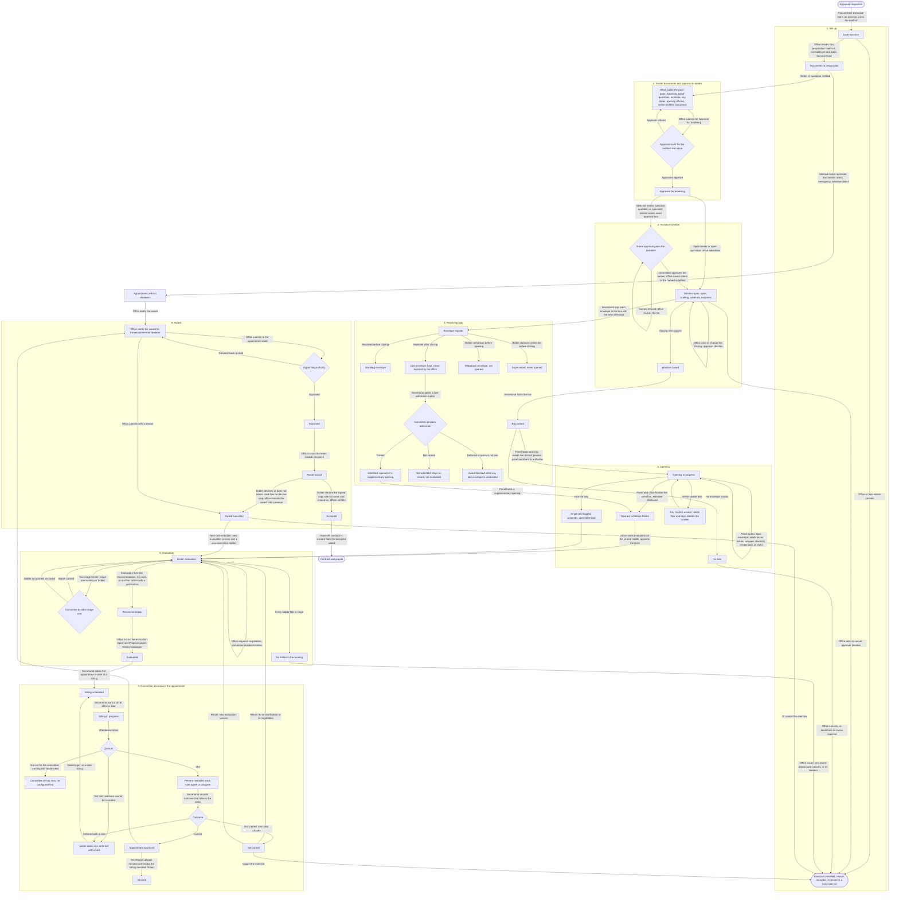

# Sourcing and Committees QA (tender, quotation, committee sittings)

Tested 2026-11-02 against the running dev server (localhost:3000, founder's demo database), headless Chrome driven over the DevTools protocol.
Tester scope: Sourcing (tenders and quotations) and Committees. Requisition and Project were covered by other testers.
No source, schema or config was changed. Showcase records (demo_sx16, sx14, sx22, sx21, sittings mt13, mt14, mt7, mt20, awards aw7, aw5, aw3, aw13) were only read.

## 1. Workflow diagram (approved requisition to award issued)

Derived from the code (`src/app/sourcing/**`, `src/lib/method`, `src/lib/bids`, `src/lib/opening`, `src/lib/evaluation`, `src/lib/committee`, `src/app/committees/**`, `src/lib/award`, `src/app/awards/**`), not from the UI alone. Where the code is silent (for example an award "declined by the bidder") the diagram says so and shows what the system actually offers.

Notes on the diagram (not render-checked with a Mermaid renderer; a few cross-phase edges sit inside their subgraph, so a node may be drawn in a neighbouring phase box):
- "Non-award notice" (`issueNonAwardNotice`) tells unsuccessful bidders; it exists as an action on the exercise.
- An exercise cannot be cancelled while a live award exists: the award is cancelled first (`exerciseCancelBlockedBy`).
- A late envelope never stops the opening, but blocks tabling or citing the appointment until each late envelope has a decided admission.

## 2. Test results

Screenshots are in `C:\Users\MOHAMA~1\AppData\Local\Temp\claude\c--Users-MohamadHaikalHarizbi-projects-perolehan\2aa89ad0-6972-46e7-8fb0-199c5c2c82a5\scratchpad\qa-sourcing\` (file name below plus `.jpg`).
Result key: PASS, FAIL (a defect, see section 3), BLOCKED (cannot be done from the screen, or not reached in the time), NOTE (works, with an observation), NOT RUN.

| ID | Scenario | Steps | Expected | Actual | Result | Screenshot |
| --- | --- | --- | --- | --- | --- | --- |
| S-01 | Exercise list loads | chen: /sourcing | List, filters, counts, no error | 23 exercises, filters by department, method and stage; "New exercise" present | PASS | sourcing-list |
| S-02 | Read every tab and section of showcase exercises | chen: overview, award, history, access, 8 scope sections, 2 documents sections, 4 bids sections for sx16, sx21, sx30, sx20 | HTTP 200, content, no error text | All 200 with content. Session expired part-way through sx20 (B-12), so sx18, sx17, sx14, sx22, sx19 and the lighter exercises were not crawled | PASS (partial) | n/a |
| S-03 | Evaluation tab and its six sections on a showcase exercise | kumar (evaluation team): sx16 evaluation, stages. chen and daniel: same URL | Evaluation team reads scores; others see a restricted view | kumar sees staged scores per bidder with pass marks. chen and daniel see the model summary and "The evaluation: Hidden". All six section URLs show chen the same restricted summary | PASS (by design, SULIT) | sx16-eval-stages-chen, sx16-eval-overview |
| S-04 | Committee showcase sittings read | chen: mt13, mt14, mt7, mt20, four tabs each | 200 and content | mt13, mt14, mt7 and mt20 load with content on all four tabs. The other sittings were not opened | PASS | n/a |
| S-05 | Not-found ids | /sourcing/nonexistent-id, /committees/nonexistent-id, /awards/nonexistent | A not-found page | A "404" page renders for all three (the HTTP status reads 200 because the page streams); no crash | PASS | n/a |
| S-06 | Create an exercise from an approved requisition | daniel: /sourcing/new?requisition=demo_rq26, title, value 140000, delivered = goods, method = open quotation, basis = bill of quantities, Start | Exercise in Draft, numbered | DEMO/SX/0026/2026 created, Draft; band and approver shown (Quotation Committee, Chief Executive) | PASS | qa-ex1-created, qa-ex1-overview |
| S-07 | Create with required fields empty | Start with nothing filled | Field errors | Not run (the form shows required markers on title, value, delivered, method) | NOT RUN | new-form-rq26 |
| S-08 | Move to preparation | daniel: Move to preparation, confirm | Documents in preparation; method, type, basis fixed | Moved. The dialog states what becomes fixed | PASS | qa-ex1-moveprep |
| S-09 | Start the tender documents | Tender documents tab, Start | Pack from the configured templates | Version 1, 10 parts. 5 merged-text parts Ready, 5 file parts Not ready | PASS | qa-ex1-docs3 |
| S-10 | Upload document files | Upload parts 4, 6, 7, 8, 9 (test PDF) through the real file input | Part becomes Ready | All five Ready (file drawer needs "Upload", then "Upload and attach") | PASS | qa-ex1-docs3 |
| S-11 | Fill the Appendix and add a variation limit | Appendix page: officers, insurance, LAD 0.05%, no sectional, no DLP, interim minima; add a limit | Appendix complete | Saved; policy defaults are marked "(assumed)" | PASS | qa-ex1-appendix |
| S-12 | Submit for approval with the pack incomplete | Submit for approval | Refused, every blocker named | Refused with 12 blockers named (estimate not lodged, eligibility test not set, restriction and permit unanswered, assurance, key dates, 2 opening officers, notice and fee, sale mode, bid validity) | PASS (B-3, B-4) | qa-ex1-submitted |
| S-13 | Approval for tendering, advertise or invite, receive bids, late and withdrawn envelope, lock box, opening, evaluation, recommendation, report | Needs the sealed company estimate (key shares), opening officers with key shares, notice and fee, key dates, assurance and a multi-person approval route | n/a | Needs the sealed estimate and key shares, named opening officers and a multi-person approval route; not attempted in the time. Sealed keys and the bidder portal are BLOCKED; the rest was skipped for time. Those steps were only read on showcase exercises | BLOCKED | qa-ex1-submit-dialog |
| S-14 | Late envelope, withdrawn envelope, lock box, opening panel authorisation | As S-13 | n/a | Read only on sx16, sx20, sx21, sx30 (Bids and opening loads). Not acted on, to protect the showcase | BLOCKED | n/a |
| S-15 | Online sealed bids, key unseal | Needs the bidder portal and keys | n/a | Not attempted | BLOCKED | n/a |
| C-01 | Schedule a sitting with nothing filled | chen: Schedule sitting, submit empty | "Committee is required", "Date is required" | Both shown | PASS | c-schedule-empty |
| C-02 | Schedule a Quotation Committee sitting | Quotation Committee, 3 Nov, agenda | Created, numbered, listed | DEMO/SIT/8/2026 created, "None tabled" | PASS (B-6) | c-qa-sitting-created |
| C-03 | Table a matter, empty form | Table a matter, submit empty | Errors | Subject, matter and act flagged | PASS | n/a |
| C-04 | Table three matters | A (carry), B (vote against), C (defer); domain Purchase, act Approve | Three pending matters | 3 tabled, 3 pending | PASS | c-qa1-3matters |
| C-05 | Start a sitting the day before its date | Start the sitting dated tomorrow | Refused | "A sitting cannot start before the day it is dated." | PASS | c-qa1-start-result |
| C-06 | Edit the sitting date, then start on the day | Change date to today, Start | In progress | In progress, "0 of 2 present" | PASS (B-9) | c-qa1-attendance3 |
| C-07 | Quorum not met, none present | Open the agenda | Not quorate, outcome blocked | "Not quorate - 0 of 2 required members present, 2 short"; Record outcome disabled | PASS | c-qa1-attendance3 |
| C-08 | Quorum not met, one of two present | chen marks Bala present | Still not quorate | "1 of 2 present", "Needs 1 more voting member present"; Record outcome disabled | PASS | c-qa1-1present |
| C-09 | Quorum met | chen marks Daniel present | Quorate | "Quorate - 2 of 2 required members present" | PASS | n/a |
| C-10 | A member records another member's vote | bala saves Daniel's vote | Refused | Refused with a clear message (only the Secretariat holder records on someone's behalf). The screen should not have offered it (B-8) | PASS (security) | c-bala-for-daniel2 |
| C-11 | Members vote for themselves | bala and daniel on A (agree, agree) and B (disagree, disagree) | Tally updates; A Carried, B Not carried | A: 2 agree, "Carried"; B: 0 agree 2 disagree, "Not carried" | PASS (B-7) | n/a |
| C-12 | Outcome that contradicts the votes | chen: B outcome "Carried" | Refused | Not recorded; dialog stays open and says "Votes come to Not carried. The outcome must follow them." (the refusal text itself was not captured) | PASS | n/a |
| C-13 | Not carried without a next step | chen: B Not carried, no "what happens next" | Field error | "Choose what happens to the matter next." | PASS | n/a |
| C-14 | Record outcomes | A Carried; B Not carried with next step and note | Recorded with quorum and rule | Recorded; decided-on date, voting rule "(assumed)" and quorum at recording shown | PASS | c-qa1-decided |
| C-15 | Not-approved memo | After C-14 | Memo issued per the notification rule | "Memo not issued: no notification rule is set for a matter not carried" | NOTE (config gap, stated honestly) | c-qa1-decided |
| C-16 | Defer needs a note | C: Defer with no note, then with a note | Refused, then recorded | "Say why, in a note.", then deferred; "3 tabled, 0 pending" | PASS | n/a |
| C-17 | Minute the sitting | Minutes tab: upload minutes, Mark as minuted | Frozen with register snapshot | Button disabled until minutes uploaded; then Minuted, "Shown from the register frozen at minuting" | PASS | c-qa1-minuted |
| C-18 | Quorum not set | Schedule Tender Opening Committee sitting, table a matter, start | Honest "not set", nothing decidable | "Quorum: Not set"; "Can't be decided until the committee's quorum and voting rule are set"; Record outcome disabled | PASS | c-qa2-quorum-unset |
| C-19 | Person without the right tables a matter | kumar and admin1: Table a matter | Refused | "Only the Secretariat holder can table matters." | PASS | n/a |
| C-20 | Person without the right schedules a sitting | kumar (opening panel, evaluation team): Schedule sitting, Quotation Committee | Refused, or open to staff by design | Allowed. DEMO/SIT/10/2026 was created (by kumar, inferred; cancelled afterwards) | NOTE (B-2: confirm intent) | n/a |
| C-21 | Cancel a sitting | chen: cancel SIT/9 and SIT/10 with a reason | Cancelled, reason shown | Both show "Cancelled: QA cleanup: test sitting" | PASS | n/a |
| C-22 | Settings-only account on transaction screens | admin1: sourcing list, exercise, New exercise, a sitting | Little or no access | Opens all of them, SULIT hidden; shown Schedule sitting and Table a matter (tabling refused, C-19) | NOTE (B-10) | n/a |
| C-23 | Sign in as demo.gopal.nair | Shared demo password, three attempts | Signs in | "Sign-in failed". The database has no account named demo.gopal.nair (the only similar login is gopal.tester, pending activation); nothing was locked | NOTE (wrong login name in the brief, B-1) | n/a |
| A-01 | Award tab of a new exercise before evaluation | /sourcing/<QA1>?tab=award | Award blocked until evaluated | Tab loads; not acted on | BLOCKED (needs S-13) | n/a |
| A-02 | Award letter, acceptance and return, bonds, hand-off to contract, award declined | /awards | Needs an evaluated exercise with a carried appointment matter | The /awards list loads (read). The four showcase awards were not opened and no new award could be created | BLOCKED | n/a |

Totals: 40 cases. PASS 28, PASS (partial) 1, NOTE 5, FAIL 0, BLOCKED 5, NOT RUN 1 (S-13, S-14, S-15, A-01, A-02 are BLOCKED; S-07 is NOT RUN).

## 3. Bugs, ranked

Blocker for the demo: none found on the paths a presenter would use (list, showcase exercises, the sitting lifecycle, quorum states). No Major defect was confirmed; the items that first looked Major were checked against the code and the database and moved to "To confirm".

### Major

None confirmed.

### To confirm (not defects until the owner says)

**B-1. demo.gopal.nair cannot sign in.** The account does not exist: the database holds `gopal.tester` (pending activation) and no `demo.gopal.nair`. Not a bug; the login name in the brief is wrong. Nothing was locked (no failed-attempt counter to clear). Do not plan a persona on this name.

**B-2. Any non-administrator staff member can schedule a committee sitting; only the Secretariat holder can table a matter.** Steps: sign in as demo.kumar.selvam, /committees, Schedule sitting, Quotation Committee, any date, Schedule. DEMO/SIT/10/2026 was created (creator inferred from the session used; the audit table was not queried). Cause: `scheduleSitting` is guarded by `staffForAct("HOLDER_CHECKED")`, which only keeps administrators out, and the dialog says the Secretariat holder is "Needed if any is ticked", so it may be open to staff by design. Decide whether an evaluation-team member should be able to schedule a Tender Board sitting. The administrator account was refused.

**B-3. A new exercise cannot get past Approval for Tendering from the screen** (a demo data gap and a gate working as designed). Submit for approval lists 12 blockers: estimate not lodged, eligibility test not set (Configuration, Reference data), restriction and permit unanswered, assurance, key dates, 2 opening officers, notice and fee, sale mode, bid validity. Use the showcase exercises for the tender flow; a live "create a tender" cannot reach publication in minutes.

### Minor

**B-4. The refusal on Submit for approval is one run-on paragraph.** Twelve problems joined with full stops in one block, no list, no links. Hard to read on stage (qa-ex1-submitted).

**B-5. The Appendix for a Supply quotation asks for works-only terms** (variation limits, interim certificates, sectional completion) and requires all of them before the pack can be submitted, while the page itself says "The contract type has no defects liability period."

**B-6. New sittings of a committee use a different number series from its seeded ones.** Quotation Committee sittings are DEMO/SQ/1, 1A, 1B, 2; the new one is DEMO/SIT/8/2026.

**B-7. A member's own vote asks for a "Date on the signed sheet" and reads "Vote cast by Bala Krishnan - sheet dated 02 Nov 2026".** Right for a paper vote the Secretariat records, confusing for a signed-in member voting for themself.

**B-8. The screen offers an act the server refuses.** A non-Secretariat member sees Agree/Disagree and the signed-sheet form against other members' seats (bala on Daniel's seat). Saving is refused with a clear message, so no data risk (c-bala-for-daniel2).

**B-9. Edit-sitting and cancel-sitting are icon buttons with no accessible name or tooltip, and the edit drawer has no title.** Steps: open a scheduled sitting; two unlabeled icons to the right of Start.

**B-10. The settings-only account (demo.admin1) opens transaction screens.** It opens the sourcing list, an exercise, New exercise and sitting pages, and is shown Schedule sitting and Table a matter. SULIT values are hidden and both acts are refused, but "settings only" suggests these screens should not open, or should hide the buttons.

**B-11. Small polish.**
- The Help button tooltip reads "Help is not built yet" in the header on every screen.
- Schedule sitting: "Committee is required." stays on screen after a committee is chosen.
- A tender-document "Why" line reads "Template: No template se." (looks truncated; the source string is "No template set").
- Scheduled sittings dated 14, 15 and 20 October count as "Upcoming" while today is 2 Nov (may be the demo clock; check before the demo).

**B-12. A session ended during a long crawl** (chen; later requests landed on /sign-in). Seen once; cause not isolated (two of my scripts may have driven the same browser tab). Sign in again just before the demo.

## 4. Safe to demo / avoid

Safe to demo:
- The exercises list, and on the showcase exercises: Overview with the process flow, Scope and estimate, Tender documents (pack with its parts), Bids and opening (received, opening, schedule). Read them; do not act on them.
- Evaluation: sign in as demo.kumar.selvam (evaluation team) to show staged scores. Chen, Daniel and the chairs see only the restricted summary (intended, SULIT), which looks empty to an audience that does not know it.
- A full committee sitting, which is quick and clean: schedule it dated today, table matters as the Secretariat (chen), start, mark attendance, show "not quorate" with one member then quorate, members vote as themselves, record Carried and Not carried (a contradicting outcome is refused), defer with a note, upload minutes, mark minuted. DEMO/SIT/8/2026 (QA) shows the finished result.
- Quorum not set: a Tender Opening Committee sitting says so and refuses to decide.

Avoid:
- Creating a brand-new tender live (B-3); it needs the sealed estimate and cannot reach publication in minutes.
- demo.gopal.nair (no such account, B-1).
- Scheduling a sitting from a non-Secretariat account until B-2 is decided.
- Leaning on the "Upcoming" count or the Help button (B-11).
- Acting on the showcase records (sx16, sx14, sx22, sx21, mt13, mt14, mt7, mt20, aw3, aw5, aw7, aw13).

## 5. QA records created (left in the database)

| Record | Id | State |
| --- | --- | --- |
| Exercise "QA Telemetry quotation A", DEMO/SX/0026/2026 (from requisition DEMO/REQ/0033/2026, demo_rq26) | cmvynos1900e3s4kcoddzf8c8 | Documents in preparation; pack version 1 with 5 uploaded test PDFs and a complete Appendix; Submit refused as in S-12. Its requisition now counts as being sourced |
| Sitting DEMO/SIT/8/2026, Quotation Committee | cmvyo86lv00vrs4kc5soly7mq | Minuted; matters "QA matter A" (Carried), "QA matter B" (Not carried), "QA matter C" (Deferred); QA minutes PDF |
| Sitting DEMO/SIT/9/2026, Tender Opening Committee | cmvyoriyo01b2s4kcsyghw84f | Cancelled, with its pending matter "QA opening matter" |
| Sitting DEMO/SIT/10/2026, Quotation Committee (created by kumar) | cmvyowymw01dns4kcvmkusp7w | Cancelled |

No award was created and no showcase record was changed. Sitting numbers 8, 9 and 10 are used.
